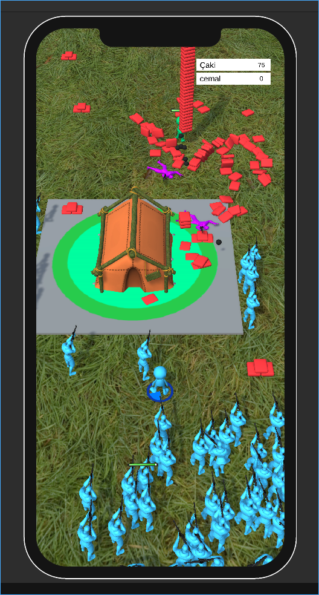
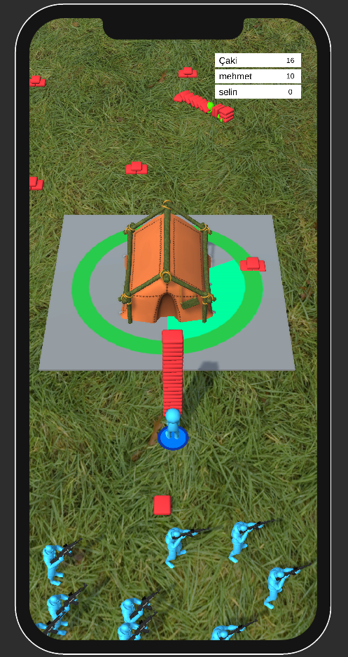
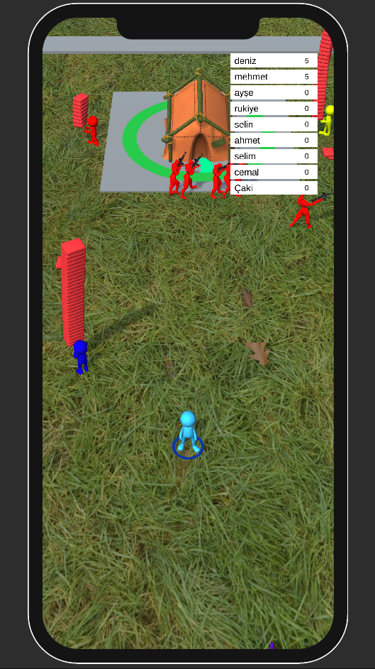
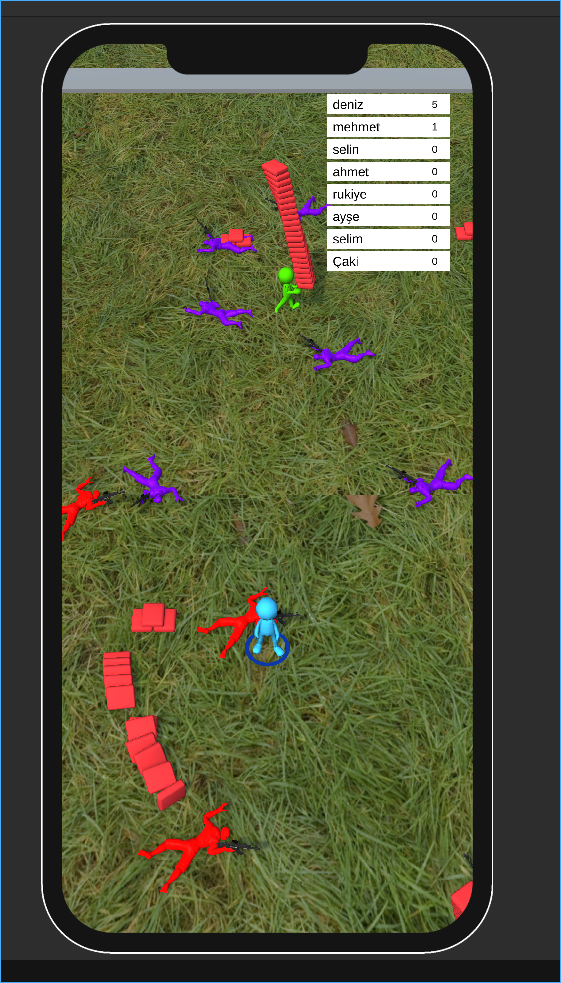
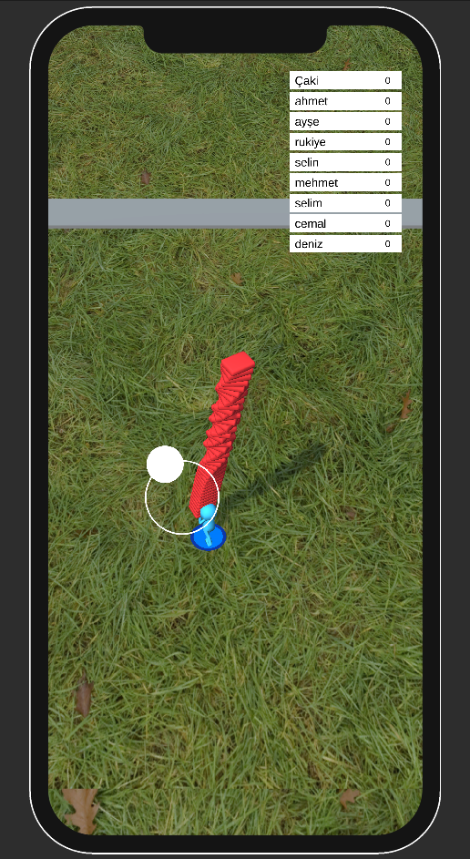
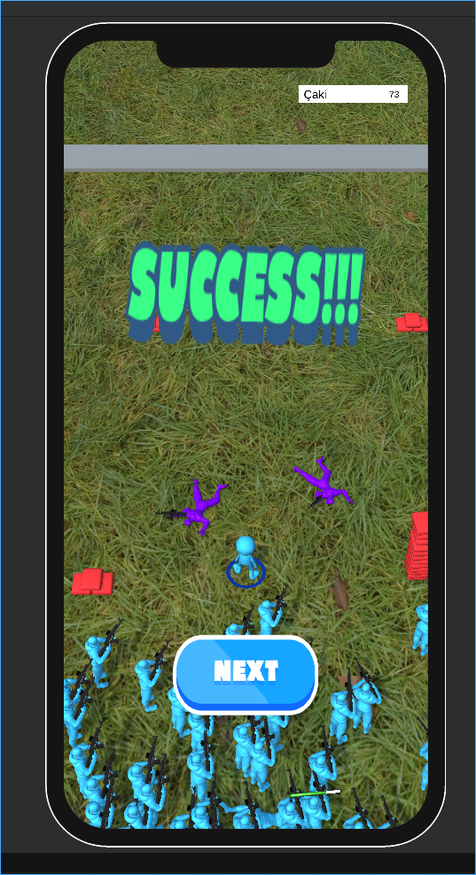
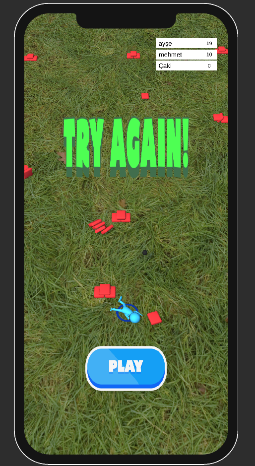

# ScoutsBattle

Yerden kütük toplayıp kamp kurulan, kampta yetişen askerlerle düşman ordularına karşı savaşılan bir arcade idle mobil oyun.

## Neden?

Toplama, biriktirme ve harcama döngüsüne dayanan idle mekaniğini; kalabalık asker gruplarının hareketini ve birbirine ateş eden iki orduyu tek oyunda denemek için yapıldı.

## Oynanış

- Oyuncu joystick ile dolaşıp yerdeki kütükleri topluyor, kütükler sırtında yığın olarak taşınıyor.
- Yeterli kütük toplanınca kamp kuruluyor ve kampta asker yetişmeye başlıyor.
- Yetişen asker sayısı getirilen odun miktarına bağlı.
- Askerler düşmanlara ateş ediyor. Düşmanın askerleri varsa önce onları hedefliyor.
- Düşman ordularının durumu lider tablosunda görülüyor.

## Ekranlar

| Asker yetiştirme | Lider tablosu |
|---|---|
|  |  |
| **Ölen askerler** | **Toplama efekti** |
|  |  |
| **Kazanma** | **Tekrar dene** |
|  |  |

## Teknik

| | |
|---|---|
| **Motor** | Unity 2022.1.7f1 |
| **Kullanılanlar** | NavMesh Agent, DOTween, Cinemachine, joystick, olay sistemi, nesne havuzu |
| **Kod** | `Assets/Codes` (karakter, toplama, düşman, asker, yöneticiler) |
| **GitHub'a yükleme** | Mart 2023 |
